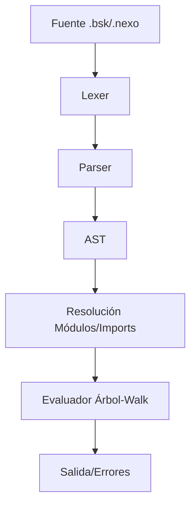
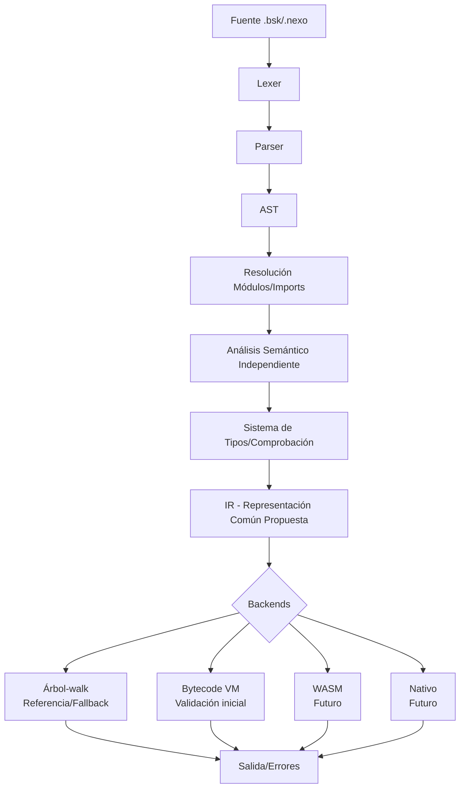

# ARQUITECTURA MAESTRA DE BASILISCO

**Versión:** Borrador estratégico  
**Estado:** Pendiente de revisión y aprobación  
**Ámbito:** Lenguaje de programación de propósito general  
**Protocolo:** R.C.T.F.R. (solo planificación/documentación)  
**Fase 6:** Cerrada  
**Referencia:** BASILISCO 0.5.0 (prototipo evaluado como referencia técnica)

---

## 1. Visión, propósito y criterios de éxito

### 1.1 Visión
**[INFERRED]** BASILISCO aspira a ser un lenguaje de programación de propósito general con identidad en español, capaz de desarrollar software para los cinco dominios desde un ecosistema coherente.

### 1.2 ¿Qué significa "propósito general"?
**[INFERRED]** Significa compartir una semántica común, un sistema de módulos coherente y principios unificados, permitiendo que distintos dominios reutilicen el núcleo del lenguaje. **No significa** que todos los dominios compartan el mismo runtime.

### 1.3 Capacidades: núcleo vs bibliotecas/runtimes/herramientas
| Elemento | Clasificación | Justificación |
|---|---|---|
| Sintaxis, léxico, parser, AST | **Núcleo** | Base del lenguaje |
| Sistema de módulos/nombres/resolución | **Núcleo** | Fundamental para reutilización |
| Sistema de tipos (modelo base) | **Núcleo** | Afecta semántica y herramientas |
| Análisis semántico independiente | **Núcleo** | Base para `check`, LSP, optimización |
| IR/bytecode (diseño propuesto) | **Arquitectónico (propuesto, no núcleo)** | Componente arquitectónico propuesto, diseño formal pendiente de aprobación. No implementado. Habilitador multi-destino si se valida. |
| Runtimes (árbol-walk/VM/nativo/WASM) | **Arquitectura** | Múltiples destinos posibles |
| Biblioteca estándar por dominio | **Biblioteca** | Extensible, modular |
| FFI/bindings | **Interoperabilidad** | Puente a ecosistemas externos |
| fmt/check/LSP/debugger | **Herramientas** | Soporte al desarrollo |
| Gestor de paquetes/registry | **Ecosistema** | Distribución a futuro |

### 1.4 Criterios de éxito
- **Semántica unificada:** Un mismo código semánticamente válido debe comportarse coherentemente entre backends cuando sea aplicable.
- **Interoperabilidad pragmática:** Integración con C ABI, y potencialmente con Rust/JS/WASM.
- **Modularidad real:** Módulos locales funcionales y camino claro a paquetes.
- **Diagnósticos útiles:** Errores con archivo/línea/columna y mensajes claros.
- **Evolutivo:** Compatible deliberadamente con programas existentes cuando sea razonable.
- **Herramientas desde temprano:** Diseño pensando en análisis estático, formateo y conformidad.

**[NOT VERIFIED]** Ninguno de estos criterios se considera "cumplido" en su totalidad actualmente.

---

## 2. Diagnóstico técnico actual

### 2.1 Estado real del repositorio
**[VERIFIED]** 
- Repo: `/home/auron/Escritorio/nexo-base-ultra-completa-0.2/nexo-base-ultra-completa-0.2/`
- Rama: `main` @ `03726fa` "BASILISCO 0.5.0 - listo para publicación"
- `cargo test` en `prototipo/`: **todos los tests existentes pasan** (0 fallos)
- Trabajo sucio: modificaciones en `00-gobernanza/estado-del-proyecto.md`, `08-plan/plan-v0.5.md`, `README.md` + untracked documentales/ADR/reportes
- `prototipo/src/vm.rs` presente pero **aislado** (no integrado al path principal)
- Fase 6 cerrada

### 2.2 Capacidades implementadas y verificadas
| Componente | Estado | Evidencia |
|---|---|---|
| Lexer/Parser/AST | `[VERIFIED]` | Código + tests verdes |
| Evaluador árbol-walk | `[VERIFIED]` | Ejecución funcional, demo/run |
| CLI (`basilisco`/`bsk`) | `[VERIFIED]` | Comandos `nuevo`, `run`, `demo`, versión/ayuda |
| Proyectos + `basilisco.toml` | `[VERIFIED]` | Parser propio sin deps, scaffolding funcional |
| Módulos/imports (`usar`/`como`/`publico`) | `[VERIFIED]` | `cargador.rs`, `evaluador.rs` integrados parcialmente |
| Tipado opcional/anotaciones | `[VERIFIED]` | `var/dato/const`, flechas, todo-o-nada |
| Control flujo/excepciones/rangos/arrays | `[VERIFIED]` | Implementados y testeados |

### 2.3 Parciales / prototipos / inexistentes
| Ítem | Estado | Notas |
|---|---|---|
| Análisis semántico independiente | `[INFERRED]` Parcial | Validaciones dispersas en parser/evaluador |
| IR/Bytecode VM integrado | `[NOT VERIFIED]` Aislado | `vm.rs` existe, no usado en ejecución principal |
| FFI/C ABI | `[MISSING]` | No evidenciado |
| Concurrencia/asincronía | `[MISSING]` | No evidenciado |
| Biblioteca estándar unificada | `[MISSING]` | Built-ins mínimos |
| Gestor de paquetes/registry | `[MISSING]` | Fuera de alcance actual |
| `fmt`/`check` funcionales | `[INFERRED]` Parcial/planificado | No funcionales en CLI según estado actual |
| LSP/debugger | `[MISSING]` | No evidenciado |

### 2.4 Deuda técnica
- **Acoplamiento:** Importaciones integradas en ejecución; análisis y ejecución mezclados.
- **Tipos híbridos:** Coexistencia `sea` legacy + anotaciones complica verificación unificada.
- **Diagnósticos:** Necesitan unificación entre carga, parseo, semántica y ejecución.
- **Sin capa intermedia:** Dificulta backends múltiples.

---

## 3. Alternativas arquitectónicas

| Alternativa | Complejidad | Portabilidad | Rendimiento Potencial | Interoperabilidad | Compatibilidad | Mantenimiento | Seguridad | Coste Evolución | Veredicto |
|---|---|---|---|---|---|---|---|---|---|
| **1) Intérprete AST evolucionado** | Baja `[VERIFIED]` | Alta `[VERIFIED]` | Limitado `[INFERRED]` | Difícil sin FFI `[INFERRED]` | Máxima `[VERIFIED]` | Bueno si modulariza `[INFERRED]` | Moderado `[INFERRED]` | Bajo `[INFERRED]` | **Viable corto plazo** |
| **2) VM con bytecode** | Media-Alta `[INFERRED]` | Alta `[INFERRED]` | Bueno `[INFERRED]` | Posible `[INFERRED]` | Media `[INFERRED]` | Moderado `[INFERRED]` | Controlable `[INFERRED]` | Medio `[INFERRED]` | **Viable intermedio** |
| **3) Compilador nativo** | Muy Alta `[INFERRED]` | Media `[INFERRED]` | Máximo `[INFERRED]` | Excelente `[INFERRED]` | Baja `[INFERRED]` | Complejo `[INFERRED]` | Requiere cuidado `[INFERRED]` | Muy Alto `[INFERRED]` | **Prematuro ahora** |
| **4) Híbrida (núcleo común + destinos)** | Alta `[INFERRED]` | Muy Alta `[INFERRED]` | Variable `[INFERRED]` | Excelente `[INFERRED]` | Media `[INFERRED]` | Complejo pero escalable `[INFERRED]` | Depende diseño `[INFERRED]` | Alto inicial `[INFERRED]` | **Objetivo a futuro** |

**Recomendación:** Arquitectura **híbrida evolutiva**. Transición: A → (introducir IR+VM) → D con backends WASM/nativo según necesidad.

---

## 4. Arquitectura de referencia

### 4.1 Capas
| Capa | Responsabilidad | Estado | Dependencias |
|---|---|---|---|
| **Fuente** | Archivos `.bsk`/`.nexo`, encoding | `[VERIFIED]` | - |
| **Lexer/Tokens** | Tokenización con ubicación | `[VERIFIED]` | Fuente |
| **Parser/AST** | Gramática y construcción AST | `[VERIFIED]` | Lexer |
| **Resolución de nombres/módulos** | Imports, visibilidad, carga, caché, ciclos | `[VERIFIED]` Parcial | Parser, FS |
| **Análisis semántico independiente** | Alcance, tipos, coherencia, restricciones | `[INFERRED]` Requerido | AST, Módulos |
| **Sistema de tipos/comprobación** | Reglas, compatibilidad, inferencia gradual | `[INFERRED]` Evolucionar | Semántica |
| **IR (propuesto)** | Representación intermedia agnóstica e independiente de backends. **No definido formalmente, no implementado.** Se evaluará forma (sin imponer SSA/pila/registros aún). | `[NOT VERIFIED]` Diseño pendiente de aprobación | Análisis semántico independiente |
| **Ejecución** | Árbol-walk (actual) / VM bytecode / interpretado | `[VERIFIED]` Parcial | IR/AST |
| **Runtime/Gestión memoria** | Valores, entornos, ciclo vida | `[INFERRED]` A definir | Ejecución |
| **Backends/Destinos** | Árbol-walk, VM, WASM, nativo | `[INFERRED]` Futuro | IR |
| **Biblioteca estándar** | Módulos por dominio | `[MISSING]` | Núcleo |
| **Interoperabilidad/Bindings** | FFI C ABI, bindings externos | `[MISSING]` | Núcleo/Runtime |
| **Herramientas** | CLI, fmt/check (alcance limitado), LSP, debugger | `[INFERRED]` Parcial | Semántica/IR |
| **Conformidad/Distribución** | Tests conformidad, paquetes | `[INFERRED]` Futuro | Todo lo anterior |

### 4.2 Flujo propuesto

#### Estado actual (verificado)

**[VERIFIED]** Camino actual: AST → Evaluador árbol-walk directamente. `vm.rs` aislado, no integrado.

#### Estado objetivo (propuesto, pendiente de validación)

**[INFERRED]** La IR es un **componente arquitectónico propuesto**, **diseño formal pendiente de aprobación**, **no implementado**. Se evaluará una representación común independiente de backends, validándola inicialmente con un **prototipo de VM**. No se impone SSA/pila/registros sin evidencia suficiente. El intérprete árbol-walk **coexistirá como referencia/fallback** durante la transición.

---

## 5. Sistema de tipos
**[INFERRED]**

| Enfoque | Pros | Contras | Recomendación |
|---|---|---|---|
| **Dinámico puro** | Flexible, simple | Difícil tooling/optimización | Insuficiente para propósito general ambicioso |
| **Estático puro** | Seguro, optimizable | Rompe compatibilidad con `sea` existente | Demasiado disruptivo ahora |
| **Gradual** | Equilibra ambos, mantiene compatibilidad | Complejo de implementar bien | **Recomendado** |

**Principios:** Mantener `sea` funcional; evolucionar anotaciones; coerción explícita donde sea dudoso; diagnósticos claros; no romper semántica existente sin justificación.

---

## 6. Memoria, errores, concurrencia y modelo de valores
**[INFERRED]**

### 6.1 Modelo de valores
**[INFERRED]** Debe analizarse explícitamente:
- **Valores vs referencias:** Diferenciar paso por valor/referencia y semántica observable.
- **Mutabilidad y aliasing:** Impacto en `var/dato/const` y colecciones.
- **Ciclo de vida:** Asociación con entornos, funciones, módulos y cierres (si existen).
- **Entornos y cierres:** Evaluar implicaciones para captura y alcance.
- **Ciclos de referencias:** Posibles con estructuras recursivas; relevante si hay conteo de referencias.
- **Uso interno actual:** Se verifica `Rc<RefCell<...>>` usado en `cargador.rs`, `evaluador.rs`, `valor.rs` (entornos/módulos). Esto es **implementación interna Rust**, no equivalente a modelo de memoria del lenguaje.
- **Implicaciones:** Intérprete, IR, VM, FFI y backends se ven afectados.

### 6.2 Gestión de memoria
| Opción | Pros | Contras | Estado |
|---|---|---|---|
| **Conteo de referencias (RC/Arc)** | Simple, determinista en muchos casos | Ciclos, overhead | **A evaluar** |
| **Ownership-like** | Seguro, eficiente | Difícil mantener compatibilidad con semántica dinámica actual | **A evaluar** |
| **Garbage Collection** | Cómodo para GC-heavy, flexible | Pausas, complejidad, difícil para tiempo real | **A evaluar** |
| **Gestión manual** | Control total | Propenso a errores, difícil DX | **A evaluar** |

**Reversibilidad:** **Baja.** Una vez establecida la representación de valores/FFI/IR, cambiar el modelo de memoria es altamente disruptivo. **No se elige definitivamente ahora.** Requiere experimento.

**Experimento propuesto EXP-08 (Memoria/Valores):**
- **Objetivo:** Comparar alternativas con casos representativos.
- **Casos:** Módulos con referencias cruzadas, cierres, colecciones mutables, aliasing, ciclos potenciales, paso entre funciones.
- **Métricas:** Correctitud semántica, comportamiento observable, impacto en diagnósticos, viabilidad FFI.
- **Criterio éxito:** Modelo propuesto preserva semántica observable sin romper tests existentes.
- **Criterio refuta:** Rompe compatibilidad o complica FFI irremediablemente.

### 6.3 Errores
| Aspecto | Opciones | Recomendación | Notas |
|---|---|---|---|
| **Errores** | Excepciones (`intentar/rescatar` existe) vs Result-style | **Mantener + unificar** | Aprovechar existente, unificar diagnóstico con archivo/línea/columna |

### 6.4 Concurrencia y asincronía
| Enfoque | Diseño/Prototipo/Implementación | Viabilidad | Notas |
|---|---|---|---|
| **Event loop** | **Diseñar primero** | Media-Alta | Adecuado para I/O asíncrono web/backend |
| **async/await** | **Diseñar primero** | Media-Alta | Requiere modelo de tareas/cancelación coherente |
| **Actores** | **Diseñar primero** | Media | Interesante pero complejo para inicio |
| **Hilos/OS threads** | **Diseñar primero** | Media | Requiere modelo memoria claro, riesgo mayor |
| **I/O síncrono ahora / async futuro** | **Evolutivo** | Alta | No bloquear consola/sistemas con async prematuro |

**Regla:** **Diseñar modelo antes de implementar.** No añadir primitivas sin caso de uso real. H6 trata diseño→experimento, **no implementación masiva**.

---

## 7. Interoperabilidad, FFI y destinos
**[INFERRED]**

### 7.1 Marco arquitectónico de FFI (seguridad)
**[INFERRED - Propuesto, no implementado]**

Principios obligatorios:
- **Opt-in:** FFI debe activarse explícitamente. Nunca habilitado por defecto.
- **Superficie mínima:** Solo lo estrictamente necesario.
- **Lista permitida de símbolos:** Whitelist por módulo/configuración, sin acceso global irrestricto.
- **Validación:** Tipos, aridad, argumentos validados en frontera.
- **Strings/buffers/punteros:** Reglas claras de propiedad, lifetime, copia vs referencia. Documentar riesgos.
- **Errores:** Mapeo a errores BASILISCO, nunca propagación silenciosa.
- **Riesgo explícito:** **Una llamada nativa puede escapar de las garantías del runtime.** El sandbox de módulos **NO** constituye barrera de seguridad frente a código nativo.
- **Sin garantías falsas:** Proponer subconjunto conservador, no afirmar eliminación de riesgos.

### 7.2 Subconjunto inicial conservador (propuesto)
**[INFERRED]** Empezar con: enteros, reales, booleanos conceptuales, strings con copia controlada, punteros opacos con lifetime documentado. Ampliar solo tras validación.

### 7.3 Destinos
| Destino | Viabilidad | Requisitos | Notas |
|---|---|---|---|
| **C ABI/FFI** | Alta a futuro | Marshalling, tipos seguros, sandboxing estricto | **Habilitador crítico**. Diseñar separado de implementar (ver H4). |
| **Rust bindings** | Media | Requiere FFI base | Requiere mayor cuidado con ownership/ABI |
| **JavaScript/WASM** | Alta | Backend WASM, host bindings | **Necesario para web frontend** |
| **Gráficos/Audio/Juegos** | Media-Baja hoy | FFI + rendimiento | Probablemente necesita VM/nativo optimizado |
| **BD/Científico** | Media | Drivers vía FFI | Factible progresivamente |

---

## 8. Los cinco dominios
**[INFERRED] - Ninguno declarado soportado integralmente**

| Dominio | Núcleo requerido | Biblioteca | Runtime/Backend | Obstáculos | Prototipo mínimo viable | **Criterios de aceptación verificables** | Estado |
|---|---|---|---|---|---|---|---|
| **Web (backend/APIs)** | Módulos, HTTP conceptos, errores | http/json/router | Backend nativo/VM | Sin red/HTTP unificado, sin stdlib HTTP | Servidor HTTP mínimo | Responde GET /ping → 200 + JSON; rutas básicas; sin crashes; errores mapeados; testeable sin browser | `[NOT VERIFIED]` |
| **Web (frontend)** | Mismo núcleo | DOM bindings | **WASM** | Sin WASM backend, sin host bindings | "Hola mundo" WASM mínimo | Compila subset a WASM; ejecuta en host controlado; semántica equivalente al árbol-walk para subset; límites documentados | `[NOT VERIFIED]` |
| **Escritorio (GUI)** | FS, SO, eventos | GUI bindings | Nativo + FFI (opt-in) | Sin FFI/gui | Ventana mínima | Ventana abre/cierra; sin bloqueos; errores claros; FFI solo opt-in; sin romper sandbox de módulos | `[NOT VERIFIED]` |
| **Consola/Sistemas** | Args, FS, procesos, errores | cli/fs/process/net | Nativo/VM | API unificada parcial | CLI con archivos + args | Lee/escribe archivo; procesa args; errores con archivo/línea/columna; funciona sin proyecto; regresión con ejemplos existentes | `[INFERRED]` Parcial |
| **Videojuegos** | Rendimiento, colecciones, tiempo | math/input/audio | Nativo/VM optimizado + FFI | Rendimiento + gráficos + FFI crítico | Bucle + entrada 2D mínimo | Bucle determinista; entrada responde; sin fugas obvias; rendimiento medible en caso real; FFI necesario documentado | `[NOT VERIFIED]` |
| **Datos/IA** | Colecciones, iteración, numéricos | csv/json/db/math | Nativo/VM/FFI | Sin libs integradas | CSV→filtrar/agregar | Lee CSV; filtra/agrega; salida correcta; errores claros; sin dependencias externas obligatorias o bien documentadas | `[NOT VERIFIED]` |

---

## 9. Biblioteca estándar y ecosistema
**[INFERRED]**

**Estrategia modular:** `std::texto`, `std::colecciones`, `std::fs`, `std::matematicas`, `std::sistema`, `std::red`, `std::json`, etc. Distinguir **estándar** (core) vs **externos** vs **bindings**.

**Futuro ecosistema:** Gestor de paquetes, manifiesto, resolución, versionado semántico, registro. **Herramientas:** `fmt` (con limitación: pérdida de comentarios si lexer los descarta), `check` (alcance limitado sin análisis semántico completo), LSP, debugger.

---

## 10. Compatibilidad y evolución (matriz)
**[INFERRED]**

| Componente | Acción | Justificación |
|---|---|---|
| Lexer/Parser/AST | **Conservar + pulir** | Sólidos, base probada |
| Evaluador árbol-walk | **Evolucionar / Coexistir como referencia/fallback** | Funcional; mantener mientras migración gradual |
| Cargador módulos/imports | **Evolucionar** | Útil, integrar con análisis semántico |
| Sistema tipos | **Evolucionar** | Crítico para propósito general |
| CLI/Proyectos | **Conservar** | Buena DX |
| vm.rs | **Experimentar aislado** | Validar IR antes de integrar |
| Documentación normativa protegida | **No tocar** | Protegido |

**Criterios de compatibilidad (obligatorios):**
- **Tests existentes:** `cargo test` debe seguir verde en cambios arquitectónicos.
- **Programas sueltos:** Preservar ejecución sin manifiesto.
- **Extensiones heredadas:** Solo si se verifica que forman parte del lenguaje (ej. `.nexo` usado actualmente). No asumir otras sin evidencia.
- **Semántica deliberada:** Cambios solo con justificación y regresión documentada.

---

## 11. Decisiones arquitectónicas registradas (ADRs pendientes)
**[INFERRED] - TODOS PENDIENTES DE APROBACIÓN**

| ADR | Título | Alternativas | Recomendación | Reversibilidad | Estado |
|---|---|---|---|---|---|
| ADR-MAESTRA-01 | Arquitectura general | A,C,D,B | **D híbrida evolutiva** | Media-Alta | **PENDIENTE** |
| ADR-MAESTRA-02 | Sistema de tipos | Dinámico/Estático/Gradual | **Gradual** | Media | **PENDIENTE** |
| ADR-MAESTRA-03 | IR/Bytecode VM | Integrar ahora/Paralelo/Nunca | **Paralelo (IR primero)** | Media | **PENDIENTE** |
| ADR-MAESTRA-04 | Gestión memoria | RC/GC/Ownership | **Investigar con experimento** | Baja-Media | **PENDIENTE** |
| ADR-MAESTRA-05 | Errores/Excepciones | Unificar modelo | **Mantener + unificar diagnóstico** | Alta | **PENDIENTE** |
| ADR-MAESTRA-06 | Concurrencia/Async | Diseñar ahora/Después | **Diseñar antes implementar** | Baja | **PENDIENTE** |
| ADR-MAESTRA-07 | FFI/ABI | C ABI + bindings | **C ABI primero** | Media | **PENDIENTE** |
| ADR-MAESTRA-08 | Backends | WASM/Nativo/Ambos | **WASM + nativo gradual** | Media | **PENDIENTE** |
| ADR-MAESTRA-09 | Compatibilidad | Estricta/Deliberada | **Deliberada + tests conformidad** | Alta | **PENDIENTE** |
| ADR-MAESTRA-10 | Ecosistema/Paquetes | Local ahora/Registry futuro | **Locales ahora, diseñar futuro** | Alta | **PENDIENTE** |

---

## 12. Hoja de ruta por hitos
**[INFERRED] - Sin fechas**

**Principio:** Árbol-walk **coexiste como referencia/fallback**. **Diseño de FFI separado de implementación.** **Concurrencia:** diseño primero, implementación posterior.

| Hito | Objetivo | Dependencias | Incluido | Excluido | Riesgo | Evidencia | Criterios aceptación | Avanzar/Detener |
|---|---|---|---|---|---|---|---|---|
| **H0** | Auditoría | - | Repo/tests/estado, distinguir actual/objetivo/futuro | Implementación | Bajo | Este doc + `cargo test` verde | Completado | Avanzar con aprobación |
| **H0.5** | **Suite de conformidad semántica** | H0 | Definir suite común, criterios equivalencia, casos regresión, incluir extensiones heredadas verificadas | Implementar backends | Medio | Suite definida + criterios | Criterios §13.1 aprobados; cubre subconjunto; regresiones documentadas | **Obligatorio antes de validar VM** |
| **H1** | Análisis semántico independiente | H0,H0.5 | Resolver nombres/imports/tipos básicos, mantener paridad | Refactor masivo | Medio | Paridad con tests + conformidad | `cargo test` verde + sin romper compatibilidad | Avanzar si paridad |
| **H2** | Sistema tipos coherente | H1 | Gradual, mantener `sea`, reglas mínimas | Romper compatibilidad | Medio-Alto | Tests + casos | Sin regresiones; tests existentes obligatorios pasan | Avanzar con cuidado |
| **H3** | IR mínimo + VM experimental | H1,H0.5 | AST→IR propuesto, VM paralelo, **sin reemplazar árbol-walk** | Reemplazar árbol-walk | Alto | **Equivalencia semántica** verificada | Usar criterios §5.1; diferencias permitidas solo justificadas y documentadas | Solo si equivalencia demostrada |
| **H4** | **Diseño FFI C ABI** (separado) | H2 | Marco seguridad, opt-in, whitelist, marshaling, subconjunto conservador | Implementación completa | Alto | Diseño aprobado | Cubre §7.1; riesgos documentados; sin código FFI | Solo diseño tras aprobación |
| **H4b** | Implementación FFI mínima | H4 | Solo si diseño validado | API amplia | Alto | Experimento controlado | Opt-in + límites + errores claros | Solo tras H4 aprobado |
| **H5** | Biblioteca std modular | H2 | Módulos sin FFI primero (texto/colecciones/matemáticas) | Módulos dependientes FFI masivos | Medio | Casos consola resueltos | APIs coherentes; sin romper módulos | Incremental |
| **H6** | Concurrencia/Async **(diseño→experimento)** | H1,H2 | Evaluar event loop/async/await/actores/hilos; modelo | Implementación producción | Alto | Diseño + spike | Sin romper sync; modelo coherente con memoria/FFI | Solo diseño/exp, no implementación |
| **H7** | WASM backend experimental | H3 | Compilar subset tras IR estable y conformidad | Frontend completo | Alto | "Hola mundo" WASM + equivalencia | Mismo comportamiento para subset; límites documentados | Tras IR estable |
| **H8** | Validación 5 dominios | H5,H4b,H7 | Usar criterios §8 por dominio | Soporte integral | Alto | Prototipos mínimos | Criterios §8 verificados | Progresivo |

---

## 13. Experimentos técnicos propuestos
**[INFERRED] - No ejecutados**

### 13.1 Criterio verificable de equivalencia semántica
**[INFERRED - Requisito]** Sustituir "paridad 100 %" por **equivalencia semántica** para el subconjunto comparado:

- **Valores/resultados:** Equivalentes para casos del subconjunto.
- **Efectos observables:** I/O, estado, mutaciones equivalentes.
- **Errores y diagnósticos:** Equivalentes cuando corresponda; diferencias justificadas y documentadas.
- **Orden de evaluación:** Respetado o diferencias justificadas.
- **Mutabilidad/estado:** Correcto en ambos backends.
- **Módulos/llamadas:** Comportamiento equivalente.
- **Suite de conformidad:** Común a backends comparados, con regresiones documentadas.
- **Diferencias permitidas:** Solo si justificadas explícitamente; **no exigir identicidad interna**.

### 13.2 Experimentos con hito vinculado
| Exp | Hito | Objetivo | Hipótesis | Método | Éxito | Refuta |
|---|---|---|---|---|---|---|
| **EXP-01** | H1 | Analizador semántico independiente | Se puede separar sin romper | Crear analizador paralelo | `cargo test` verde + paridad | Errores semánticos distintos no justificables |
| **EXP-02** | H3 | IR mínimo (propuesto) | IR agnóstico viable | Definir IR + traductor AST→IR | Traduce subset sin pérdida semántica | Divergencia semántica / pérdida ubicación |
| **EXP-03** | H3,H0.5 | Equivalencia árbol-walk vs VM | VM reproduce semántica para subset | Ejecutar **suite conformidad** en ambos | Equivalencia según §13.1 | Cualquier divergencia no justificada |
| **EXP-04** | H4,H4b | FFI C mínimo | Llamar C de forma segura/limitada | Diseño + experimento opt-in | Opt-in, whitelist, validación, errores claros | Violación límites/seguridad |
| **EXP-05** | H7 | WASM subset | Compilar subset a WASM | Backend experimental | Ejecuta en host con equivalencia | Pérdida semántica |
| **EXP-06** | H6 | Concurrencia modelo | Modelo viable | Diseño + spike (event loop/async/actores/hilos) | Sin romper sync, coherente con memoria | Complejidad excesiva / incoherente |
| **EXP-07** | H1,H2 | Compatibilidad regresión | Sin ruptura | Suite programas existentes + legado | Sin regresiones injustificadas | Rompe código legacy |
| **EXP-08** | H3,H4 | Memoria/Valores + FFI | Modelo viable | Comparar RC/ownership/GC/manual con casos §6.1 | Preserva semántica + viable FFI | Ciclos problemáticos / incompatible FFI |

---

## 14. Riesgos y cuestiones abiertas
**[INFERRED]**

| Riesgo | Probabilidad | Impacto | Mitigación |
|---|---|---|---|
| **Fragmentación semántica** | Media | Alto | Suite conformidad única |
| **Scope creep (5 dominios)** | Alta | Alto | Fundamentales primero, prototipos mínimos |
| **Migración prematura** | Media | Alto | Evolutivo, paridad obligatoria |
| **FFI inseguro** | Media | Alto | Límites explícitos, sandbox |
| **Complejidad herramienta** | Media | Alto | Incremental |
| **Pérdida compatibilidad** | Media | Alto | Tests regresión obligatorios |

**Cuestiones para el propietario:** Aprobación D-ARCH-1..10, prioridad entre dominios, tolerancia a cambio tipado gradual, recursos para experimentos.  
**Cuestiones para equipo (tras aprobación):** Diseño IR, modelo concurrencia, FFI API, suite conformidad.

---

## 15. Conclusión

**[INFERRED]** BASILISCO 0.5.0 es un prototipo funcional y valioso. Para convertirse en lenguaje de propósito general se requiere evolución arquitectónica, no solo consolidación. Recomendado: **arquitectura híbrida evolutiva** con núcleo semántico independiente, IR, backends múltiples y FFI pragmático. **Ningún dominio está soportado integralmente hoy.** Las decisiones clave quedan **pendientes de aprobación**.

**Principio rector:** *Semántica común, destinos múltiples, evolución deliberada, interoperabilidad pragmática.*
